<div align="center">

<a href="https://openaudiovisual.com">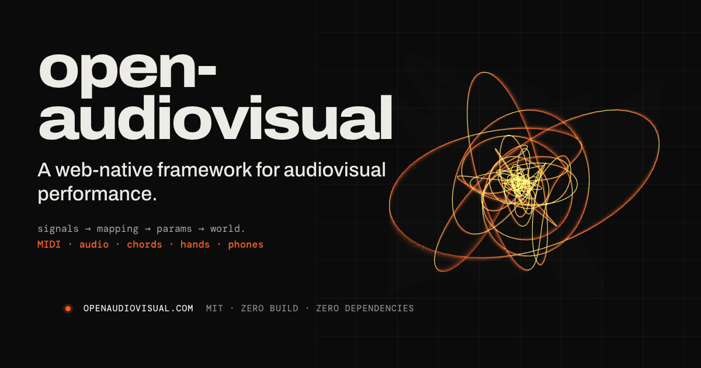</a>

**A web-native framework for audiovisual performance.**<br>
MIDI, microphones, chords, hands and phones become named signals; a mapping turns them into parameters; your world draws and sounds them.

<a href="https://github.com/frank890417/open-audiovisual/actions/workflows/checks.yml"></a>
<a href="LICENSE"></a>


<!--gen:badge-controllers--><a href="https://openaudiovisual.com/controllers/"></a><!--/gen:badge-controllers-->
<a href="https://openaudiovisual.com/docs/"></a>
<a href="https://openaudiovisual.com/zh/docs/"></a>

[**Website**](https://openaudiovisual.com) · [**Docs**](https://openaudiovisual.com/docs/) · [**繁體中文**](https://openaudiovisual.com/zh/docs/) · [**Controllers**](https://openaudiovisual.com/controllers/) · [**Examples**](#-examples) · [**p5.js in one line**](#-p5js-in-one-line)

</div>

> Hydra gives you improvisation. cables gives you a platform. Tone gives you sound.
> **open-audiovisual gives you a *show*.**

Everything TouchDesigner-class tools do on a desktop, the browser can now do with a URL:
WebGL/WebGPU rendering, Web MIDI, realtime audio analysis, on-device pose tracking.
What's been missing is the *chassis*, the part everyone rebuilds for every performance:
MIDI plumbing, signal-to-parameter mapping, a timeline with scenes and cues, a
performance mode, a backstage view. This repo is that chassis.

## ⚡ Quick start

**Zero build step. Zero dependencies.** Clone it, run one file, you're on stage:

```bash
git clone https://github.com/frank890417/open-audiovisual.git
cd open-audiovisual
node serve.js          # → http://localhost:8080  (Chrome or Edge: Web MIDI + camera)
```

Then open <http://localhost:8080/examples/01-hello-particles/> and read its `main.js`.
Every example runs without hardware: an on-screen piano, QWERTY keys and a simulated performer stand in for instruments.

Optional companions (each ~100 dependency-free lines, run in their own terminal):

```bash
node packages/monitor/server.js           # backstage monitor for the stage manager (:7457)
node packages/osc/bridges/osc-bridge.js   # OSC → UDP bridge (Spat, Reaper, TD, lights…)
```

## ✨ What's in the box

<table>
<tr>
<td width="33%" valign="top"><br><b>MIDI controllers</b><br><!--gen:n-devices-->21<!--/gen:n-devices--> real devices modeled as data: every knob, pad and key with its exact message. Play them on screen, plug the real one in.</td>
<td width="33%" valign="top"><br><b>Audio analysis</b><br>Microphone or any Web Audio node: loudness, bands, brightness, onsets, kick / snare / hat. In a p5 sketch: <code>micLevel</code>.</td>
<td width="33%" valign="top"><br><b>Chord semantics</b><br>Notes struck together become one gesture: consonance, triad, cluster. Harmony decides bloom or decay.</td>
</tr>
<tr>
<td width="33%" valign="top"><br><b>Hands &amp; body</b><br>21-point hand and body tracking in the browser, on the device. Leap Motion through one local bridge.</td>
<td width="33%" valign="top">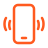<br><b>Phone &amp; iPad remote</b><br>Tilt, knock, a keyboard, and a TouchOSC-style control surface grown from your world's params.</td>
<td width="33%" valign="top"><br><b>Mapping &amp; LEARN</b><br>Signal to param routes with curve, range and smoothing. Many-to-many. Press learn, move anything, it is wired.</td>
</tr>
<tr>
<td width="33%" valign="top"><br><b>Worlds</b><br>Your piece reads params, never inputs. Draw with canvas, p5, three.js or a WebToe node patch.</td>
<td width="33%" valign="top"><br><b>Timeline &amp; Score</b><br>Automation, scenes and cues; a show written as segment lengths, with cuts, holds and a director.</td>
<td width="33%" valign="top"><br><b>Console</b><br>The director's desk: transport, sliders, learn, meters, and a performance mode on <kbd>T</kbd>.</td>
</tr>
<tr>
<td width="33%" valign="top"><br><b>Backstage monitor</b><br>Clock, scene, every signal and FPS on any phone or laptop on the network.</td>
<td width="33%" valign="top"><br><b>Performance video</b><br>The work, your hands and the work's own sound in one synced vertical or 4K file. Record MIDI takes too. In a p5 sketch: <code>startRecording()</code>.</td>
<td width="33%" valign="top"><br><b>Agent-native</b><br>AGENTS.md, a <code>/create-world</code> skill and an MCP server: describe a show, an agent writes the world.</td>
</tr>
</table>

## 🏗 Architecture

<p align="center">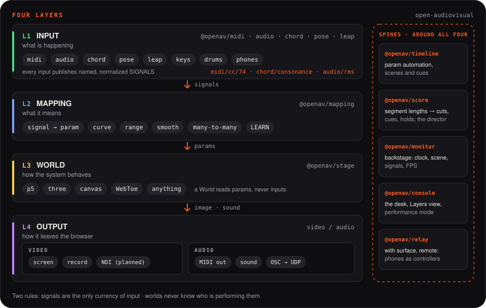</p>

Two rules make the whole thing composable:

1. **Signals are the only currency of input.** A knob, a raised hand, and a chord's
   consonance are equal citizens with names. That equality *is* input fusion.
2. **Worlds never know who is performing them.** A world reads params. Whether a
   param came from the timeline, a MIDI knob, a dancer's wrist, or a slider is
   invisible to it, so the same world can be played by a pianist, a dancer,
   or an automation curve.

<details>
<summary>The same diagram as text (for terminals, screen readers and AI agents)</summary>

```
┌────────────────────────────────────────────────────────────┐
│ L1 INPUT — "what is happening"                             │
│   @openav/midi   @openav/audio   @openav/chord  @openav/pose│
│   @openav/leap (Leap Motion, via a local bridge) · phones  │
│   → all publish named, normalized SIGNALS                  │
│     midi/cc/74 · chord/consonance · audio/rms · pose/hand/…│
├────────────────────────────────────────────────────────────┤
│ L2 MAPPING — "what it means"            @openav/mapping    │
│   signal → param routes: curve · range · smooth ·          │
│   many-to-many · live LEARN (works for knobs AND hands)    │
├────────────────────────────────────────────────────────────┤
│ L3 WORLD — "how the system behaves"     @openav/stage      │
│   a World sees params, never inputs. p5 / three / canvas / │
│   anything. Swap works; keep the shell.                    │
├────────────────────────────────────────────────────────────┤
│ L4 OUTPUT — "how it leaves the browser" (video ∥ audio)    │
│   video: screen · @openav/record · future NDI              │
│   audio: @openav/midi out · @openav/sound (Tone.js engine) │
│          · @openav/osc → UDP bridge                        │
├────────────────────────────────────────────────────────────┤
│ ⏱ @openav/timeline — param automation + scenes/cues        │
│ 📜 @openav/score — segment lengths → cuts, cues, holds;      │
│    the director runs a module per segment                   │
│ 📟 @openav/monitor — backstage: clock, scene, signals, FPS  │
│ 🎛 @openav/console — desk · Layers live view · perf mode     │
│ 📱 @openav/relay · surface · remote — phones/iPads as        │
│    controllers: rooms, TouchOSC-style widgets, autoSurface  │
└────────────────────────────────────────────────────────────┘
```

</details>

## 🖼 Examples

<!--gen:w-examples-->Twenty-six<!--/gen:w-examples--> works, all playable in the browser. In any example: <kbd>Space</kbd> plays the timeline (at a hold: releases it), <kbd>←</kbd>/<kbd>→</kbd> jump scenes, <kbd>T</kbd> is performance mode, <kbd>F</kbd> is fullscreen.

<!--gen:examples-grid-->
All examples, by route: [openaudiovisual.com/examples/](https://openaudiovisual.com/examples/)

**① First open**: Read the whole framework in one file, then add one line to a p5 sketch you already have.

<table>
<tr>
<td width="33%" align="center" valign="top"><a href="https://openaudiovisual.com/examples/01-hello-particles/">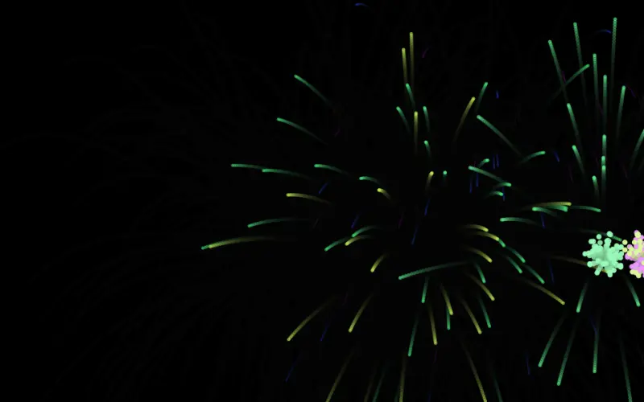</a><br><b>01 · Hello particles</b><br>The smallest complete app. Read main.js top to bottom and you know the framework.<br><a href="https://openaudiovisual.com/examples/01-hello-particles/">play</a> · <a href="examples/01-hello-particles/">source</a></td>
<td width="33%" align="center" valign="top"><a href="https://openaudiovisual.com/examples/15-p5-one-line/">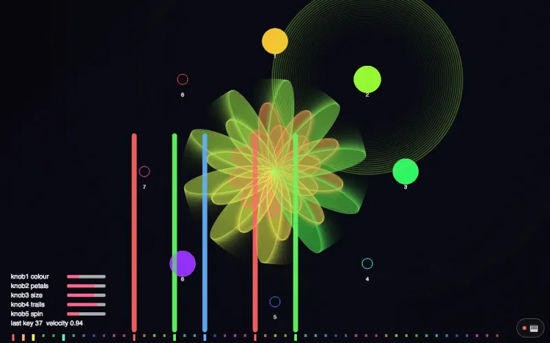</a><br><b>15 · p5.js in one line</b><br>A plain p5 sketch whose first line loads oav-p5.js, then plays from a MIDI controller, an on-screen controller or a phone.<br><a href="https://openaudiovisual.com/examples/15-p5-one-line/">play</a> · <a href="examples/15-p5-one-line/">source</a></td>
<td></td>
</tr>
</table>

**② Anything can be an instrument**: A controller, a chord, a microphone, bare hands, a Leap Motion, a phone, Strudel in another tab.

<table>
<tr>
<td width="33%" align="center" valign="top"><a href="https://openaudiovisual.com/examples/16-p5-sound/">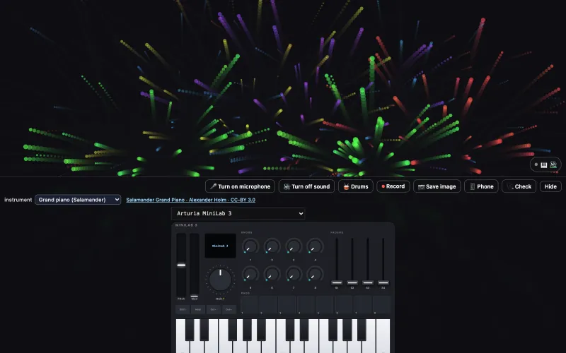</a><br><b>16 · p5 keys with sound</b><br>startSound('piano') in setup(): every key from a MIDI keyboard, the 🎹 on screen or a phone is heard, and bursts into particles.<br><a href="https://openaudiovisual.com/examples/16-p5-sound/">play</a> · <a href="examples/16-p5-sound/">source</a></td>
<td width="33%" align="center" valign="top"><a href="https://openaudiovisual.com/examples/17-p5-microphone/">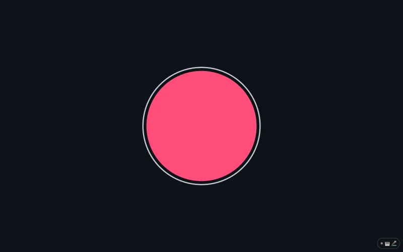</a><br><b>17 · p5 microphone</b><br>micLevel, bass and beat read the microphone the way p5 reads mouseX: a circle that grows when you speak, and no p5.sound.<br><a href="https://openaudiovisual.com/examples/17-p5-microphone/">play</a> · <a href="examples/17-p5-microphone/">source</a></td>
<td width="33%" align="center" valign="top"><a href="https://openaudiovisual.com/examples/22-p5-lag/">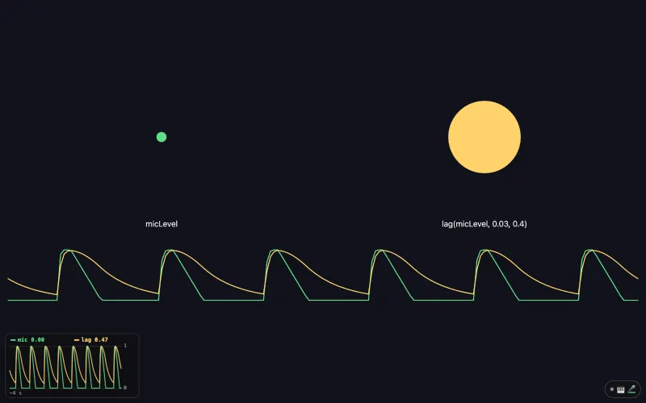</a><br><b>22 · p5 lag: smooth a jumpy value</b><br>lag(micLevel, 0.03, 0.4) smooths a jumpy value the way TouchDesigner's Lag CHOP does, in the same seconds; scope() plots both in a corner of the page.<br><a href="https://openaudiovisual.com/examples/22-p5-lag/">play</a> · <a href="examples/22-p5-lag/">source</a></td>
</tr>
<tr>
<td width="33%" align="center" valign="top"><a href="https://openaudiovisual.com/examples/09-midi-controllers/">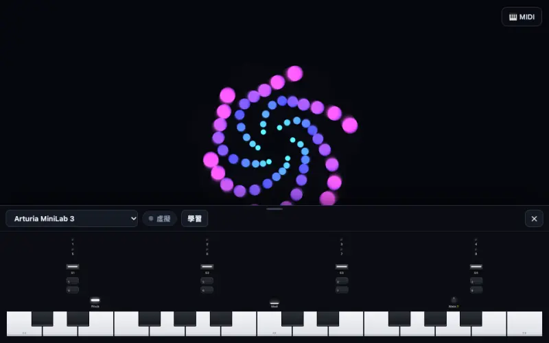</a><br><b>09 · MIDI controllers</b><br>On-screen controllers that move with the real ones you plug in.<br><a href="https://openaudiovisual.com/examples/09-midi-controllers/">play</a> · <a href="examples/09-midi-controllers/">source</a></td>
<td width="33%" align="center" valign="top"><a href="https://openaudiovisual.com/examples/02-chord-garden/">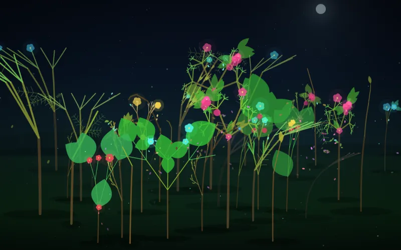</a><br><b>02 · Chord garden</b><br>Triads bloom, clusters decay. The world listens to chords, never to keys.<br><a href="https://openaudiovisual.com/examples/02-chord-garden/">play</a> · <a href="examples/02-chord-garden/">source</a></td>
<td width="33%" align="center" valign="top"><a href="https://openaudiovisual.com/examples/06-cylinder-earth/">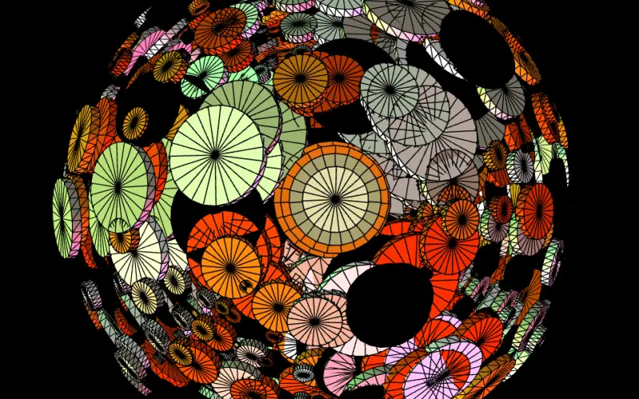</a><br><b>06 · Cylinder earth</b><br>A 2020 voice-controlled WebGL sketch; mic bands or the built-in drum machine play it.<br><a href="https://openaudiovisual.com/examples/06-cylinder-earth/">play</a> · <a href="examples/06-cylinder-earth/">source</a></td>
</tr>
<tr>
<td width="33%" align="center" valign="top"><a href="https://openaudiovisual.com/examples/03-pose-field/">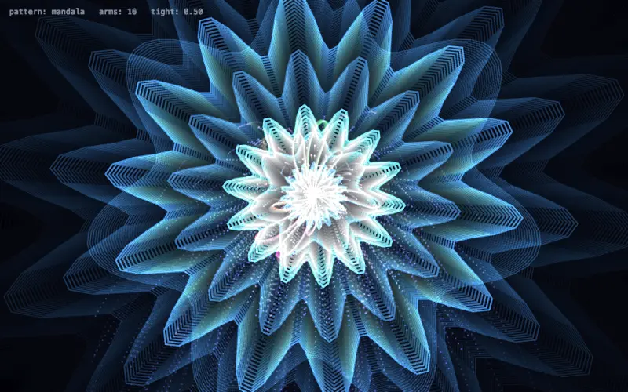</a><br><b>03 · Hand instrument</b><br>Fingers as an instrument: pinch, fists, four pattern families.<br><a href="https://openaudiovisual.com/examples/03-pose-field/">play</a> · <a href="examples/03-pose-field/">source</a></td>
<td width="33%" align="center" valign="top"><a href="https://openaudiovisual.com/examples/12-leap-hands/">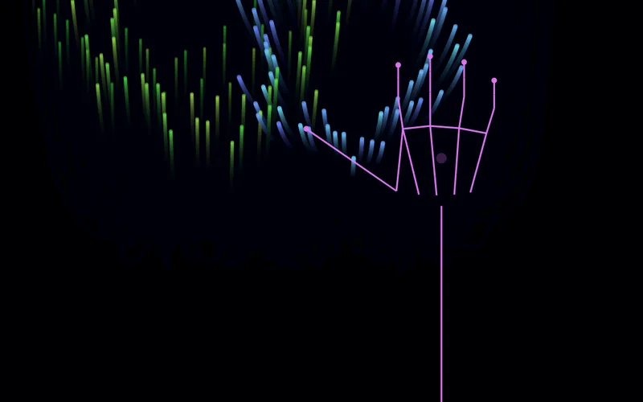</a><br><b>12 · Leap hands</b><br>A Leap Motion as an instrument; the mouse is a simulated hand when you have none.<br><a href="https://openaudiovisual.com/examples/12-leap-hands/">play</a> · <a href="examples/12-leap-hands/">source</a></td>
<td width="33%" align="center" valign="top"><a href="https://openaudiovisual.com/examples/08-remote-surface/">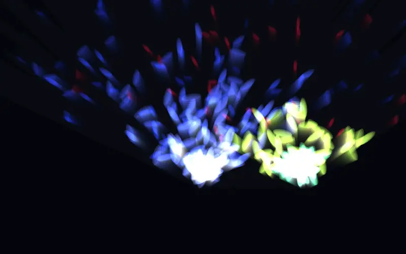</a><br><b>08 · Remote surface</b><br>The phone is the instrument panel; the surface grows from the world's params.<br><a href="https://openaudiovisual.com/examples/08-remote-surface/">play</a> · <a href="examples/08-remote-surface/">source</a></td>
</tr>
<tr>
<td width="33%" align="center" valign="top"><a href="https://openaudiovisual.com/examples/23-p5-with-strudel/">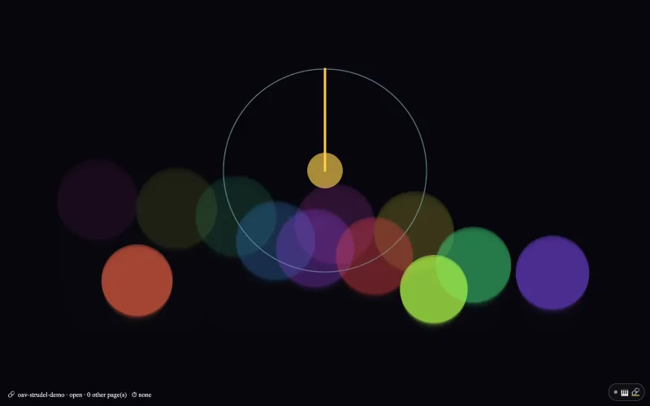</a><br><b>23 · p5 with Strudel</b><br>Strudel plays in another tab and this sketch draws: every note Strudel sends to OAV Virtual MIDI calls notePressed(), and its clock turns drumPhase.<br><a href="https://openaudiovisual.com/examples/23-p5-with-strudel/">play</a> · <a href="examples/23-p5-with-strudel/">source</a></td>
<td width="33%" align="center" valign="top"><a href="https://openaudiovisual.com/examples/24-p5-note-names/">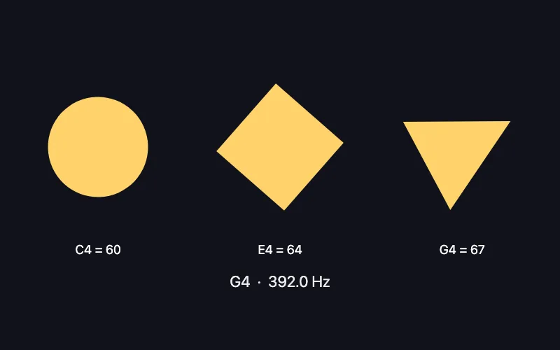</a><br><b>24 · p5 note names</b><br>noteIsDown('C4') works like noteIsDown(60): write note names (C4, c#4, Db3) wherever a note number goes; noteNumber(), noteName() and noteFreq() convert.<br><a href="https://openaudiovisual.com/examples/24-p5-note-names/">play</a> · <a href="examples/24-p5-note-names/">source</a></td>
<td width="33%" align="center" valign="top"><a href="https://openaudiovisual.com/examples/25-p5-chop/">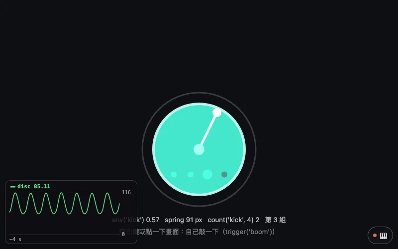</a><br><b>25 · p5 numbers that move</b><br>env('kick'), spring(), speed() and count('kick', 4) shape a number the way TouchDesigner's Trigger, Spring, Speed and Count CHOPs do: a bass drum opens a disc, a spring bounces it back, a hand turns, every fourth kick changes the colour.<br><a href="https://openaudiovisual.com/examples/25-p5-chop/">play</a> · <a href="examples/25-p5-chop/">source</a></td>
</tr>
<tr>
<td width="33%" align="center" valign="top"><a href="https://openaudiovisual.com/examples/26-p5-rhythm-lab/">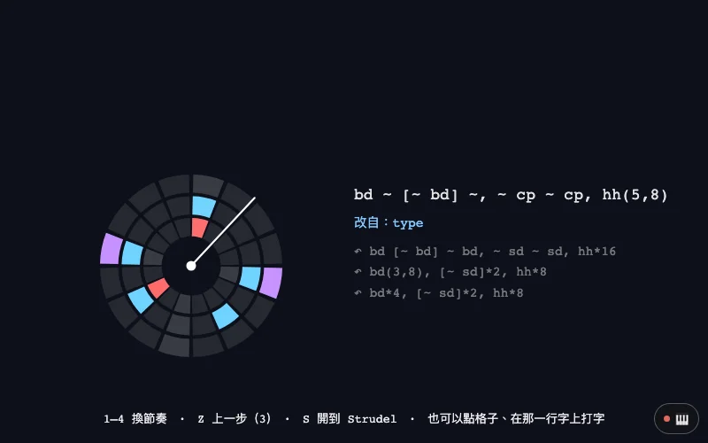</a><br><b>26 · p5 rhythm lab</b><br>OAVp5.drums.edit('bd(3,8), …') swaps the rhythm like typing it, OAVp5.drums.undo() goes back a line, OAVp5.drums.strudelUrl opens the line in Strudel; rhythmChanged() says what the line is now.<br><a href="https://openaudiovisual.com/examples/26-p5-rhythm-lab/">play</a> · <a href="examples/26-p5-rhythm-lab/">source</a></td>
<td></td>
<td></td>
</tr>
</table>

**③ Bring another picture engine**: Bring your own: a node patch, a 2023 p5 sketch, a 2021 particle system.

<table>
<tr>
<td width="33%" align="center" valign="top"><a href="https://openaudiovisual.com/examples/04-webtoe-stage/">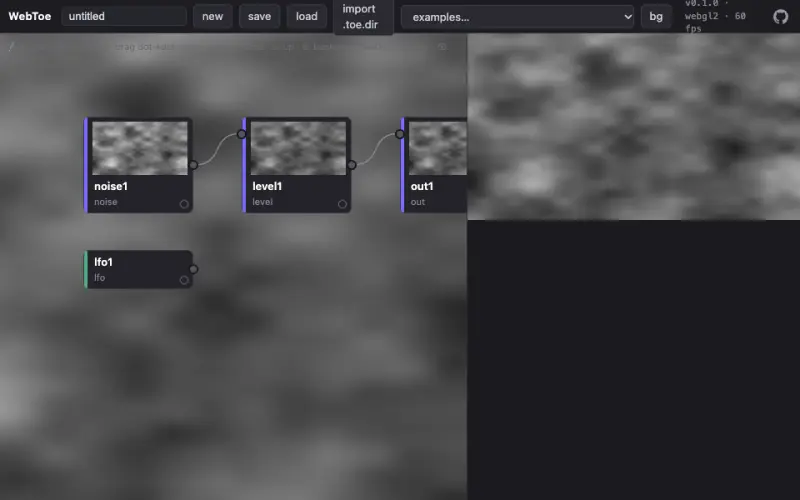</a><br><b>04 · WebToe stage</b><br>A WebToe node patch performed as a World through ext() bindings.<br><a href="https://openaudiovisual.com/examples/04-webtoe-stage/">play</a> · <a href="examples/04-webtoe-stage/">source</a></td>
<td width="33%" align="center" valign="top"><a href="https://openaudiovisual.com/examples/05-prebiotic-flake/">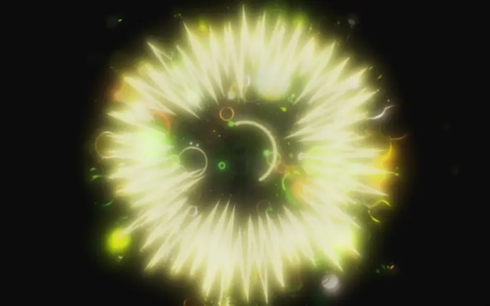</a><br><b>05 · Prebiotic flake</b><br>A 2023 MIDI sketch replayed through the framework, now with a Tone.js voice.<br><a href="https://openaudiovisual.com/examples/05-prebiotic-flake/">play</a> · <a href="examples/05-prebiotic-flake/">source</a></td>
<td width="33%" align="center" valign="top"><a href="https://openaudiovisual.com/examples/07-firework-festival/">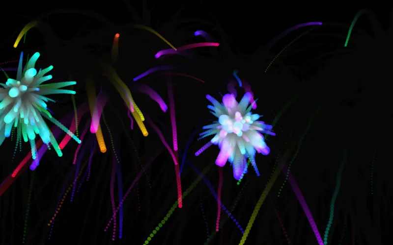</a><br><b>07 · Firework festival</b><br>Close a finger pinch and a firework launches from that hand (2021).<br><a href="https://openaudiovisual.com/examples/07-firework-festival/">play</a> · <a href="examples/07-firework-festival/">source</a></td>
</tr>
</table>

**④ Run a show**: The show, not just the piece: a timeline you can see, a drum machine that counts the bars, and a score with a director.

<table>
<tr>
<td width="33%" align="center" valign="top"><a href="https://openaudiovisual.com/examples/14-timeline/">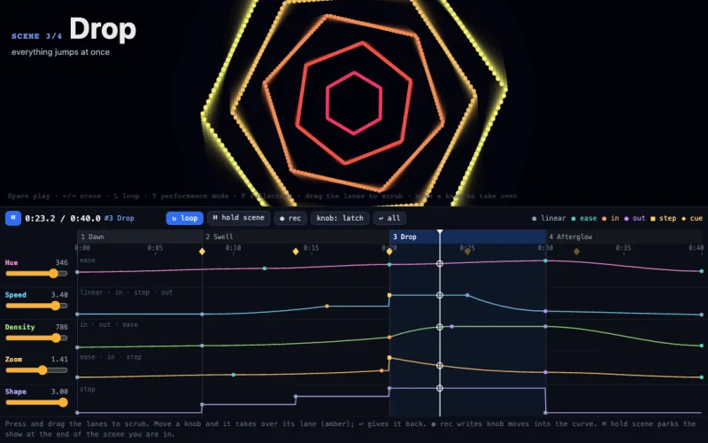</a><br><b>14 · Timeline</b><br>Automation you can see: five lanes of keyframe curves drive a ring of light, scenes cut it, cues fire one-shot flashes.<br><a href="https://openaudiovisual.com/examples/14-timeline/">play</a> · <a href="examples/14-timeline/">source</a></td>
<td width="33%" align="center" valign="top"><a href="https://openaudiovisual.com/examples/18-p5-drums/">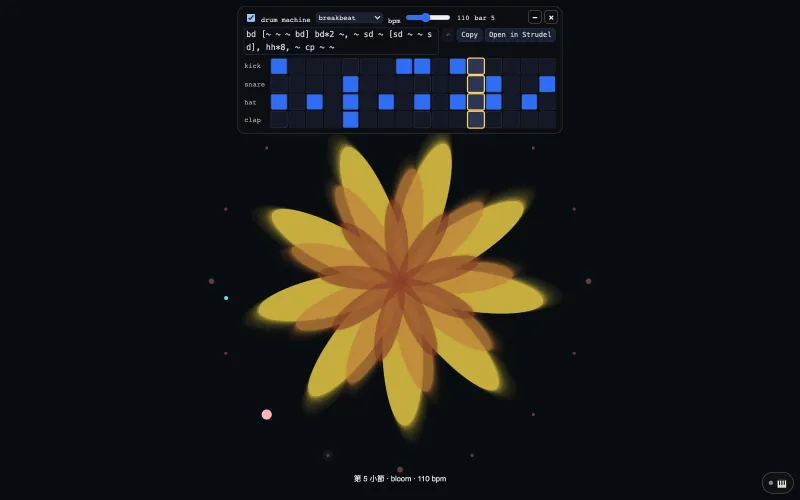</a><br><b>18 · p5 drums and bars</b><br>startDrums('breakbeat', 110) puts a 16-step drum machine on the page; kickDetected() and cueFired() turn its hits and its bars into the picture.<br><a href="https://openaudiovisual.com/examples/18-p5-drums/">play</a> · <a href="examples/18-p5-drums/">source</a></td>
<td width="33%" align="center" valign="top"><a href="https://openaudiovisual.com/examples/19-p5-rhythm/">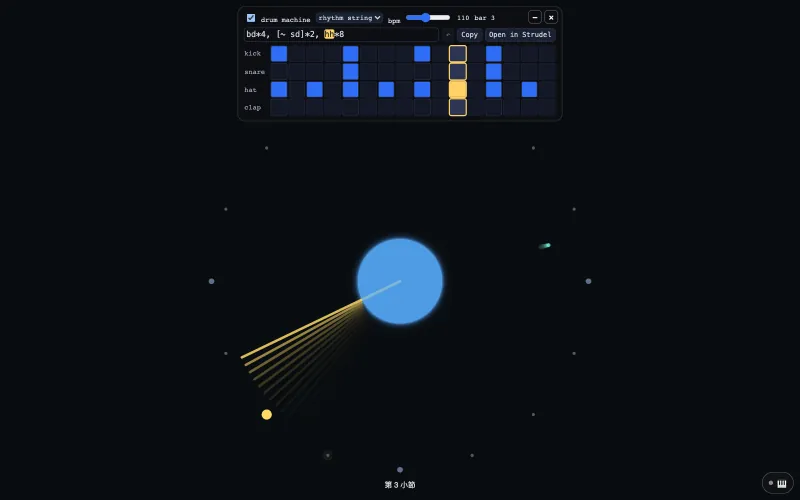</a><br><b>19 · p5 one line of rhythm</b><br>startDrums("bd*4, [~ sd]*2, hh*8") writes the drums as one line of rhythm; drumPhase and beatPhase turn a hand once a bar and swell a circle on every beat.<br><a href="https://openaudiovisual.com/examples/19-p5-rhythm/">play</a> · <a href="examples/19-p5-rhythm/">source</a></td>
</tr>
<tr>
<td width="33%" align="center" valign="top"><a href="https://openaudiovisual.com/examples/20-p5-rhythm-visual/">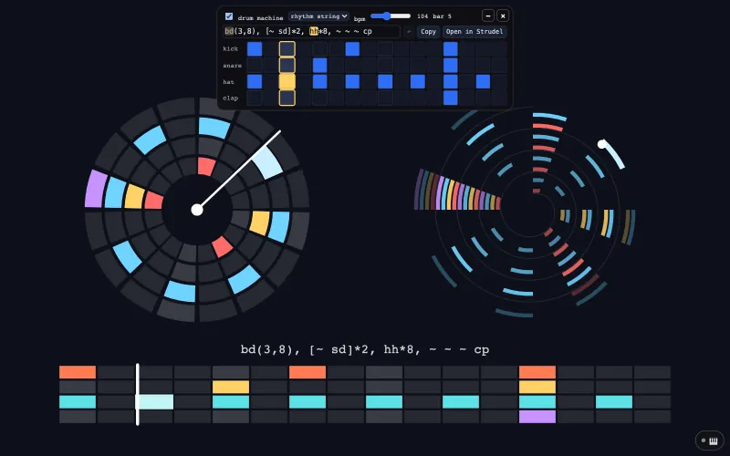</a><br><b>20 · p5 rhythm you can see</b><br>drawRhythm() draws the rhythm on the canvas as a grid, a circle or a spiral, so a recording has it; the cells and the line on the card edit each other.<br><a href="https://openaudiovisual.com/examples/20-p5-rhythm-visual/">play</a> · <a href="examples/20-p5-rhythm-visual/">source</a></td>
<td width="33%" align="center" valign="top"><a href="https://openaudiovisual.com/examples/13-score-director/">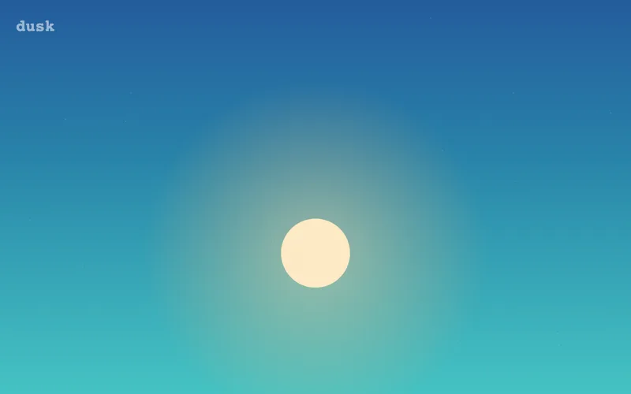</a><br><b>13 · Score &amp; director</b><br>A day of sky as segment lengths: two cuts, a hold, cues, a segment that can crash.<br><a href="https://openaudiovisual.com/examples/13-score-director/">play</a> · <a href="examples/13-score-director/">source</a></td>
<td></td>
</tr>
</table>

**⑤ Take it out of the browser**: One synced video, from one line in a p5 sketch, with or without a camera.

<table>
<tr>
<td width="33%" align="center" valign="top"><a href="https://openaudiovisual.com/examples/21-p5-record/">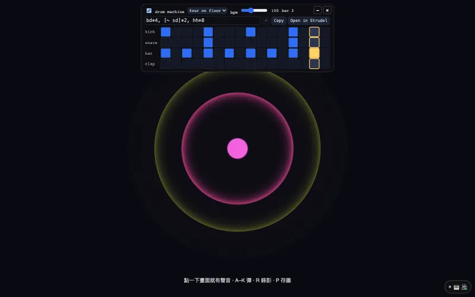</a><br><b>21 · p5 record a video</b><br>startRecording() saves the canvas and the sketch's own sound as one video, MP4 where the browser can write it; ⏺ and 📷 in the 🎹 panel need no code.<br><a href="https://openaudiovisual.com/examples/21-p5-record/">play</a> · <a href="examples/21-p5-record/">source</a></td>
<td width="33%" align="center" valign="top"><a href="https://openaudiovisual.com/examples/10-record/">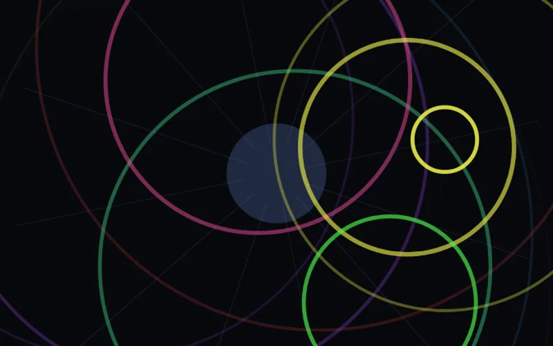</a><br><b>10 · Record</b><br>The work plus your hands plus its own sound, in one synced video. MIDI takes too.<br><a href="https://openaudiovisual.com/examples/10-record/">play</a> · <a href="examples/10-record/">source</a></td>
<td width="33%" align="center" valign="top"><a href="https://openaudiovisual.com/examples/11-controller-video/">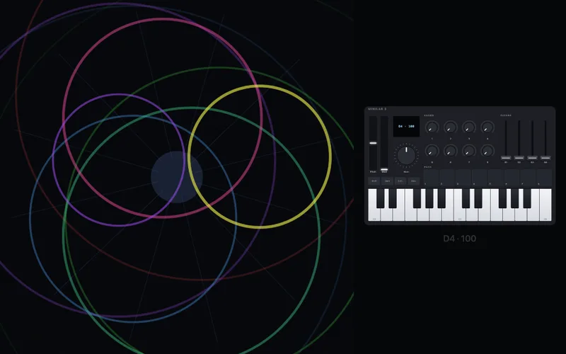</a><br><b>11 · Controller video</b><br>The performance video without a camera: the controller you play, drawn live.<br><a href="https://openaudiovisual.com/examples/11-controller-video/">play</a> · <a href="examples/11-controller-video/">source</a></td>
</tr>
</table>
<!--/gen:examples-grid-->

All examples run without MIDI hardware: every stage ships an on-screen piano
(`@openav/keys`: QWERTY capture, <kbd>Z</kbd>/<kbd>X</kbd> octave) and a **simulated performer** that
plays the piece hands-free. 01 and 02 run fully offline. Examples are assembled with
**`createShow()`** (`@openav/show`), a World plus one declarative call; the layer-aligned side
panel, inputs, sound and backstage all come from the factory, so every work evolves together
when the framework grows.

**Artwork attribution**: examples 05–07 integrate original artworks by
**Che-Yu Wu 吳哲宇** (2020–2023), used here strictly as demos. The framework is
MIT; the artworks remain © the artist, all rights reserved.

## 🎹 MIDI controller library

<a href="https://openaudiovisual.com/controllers/">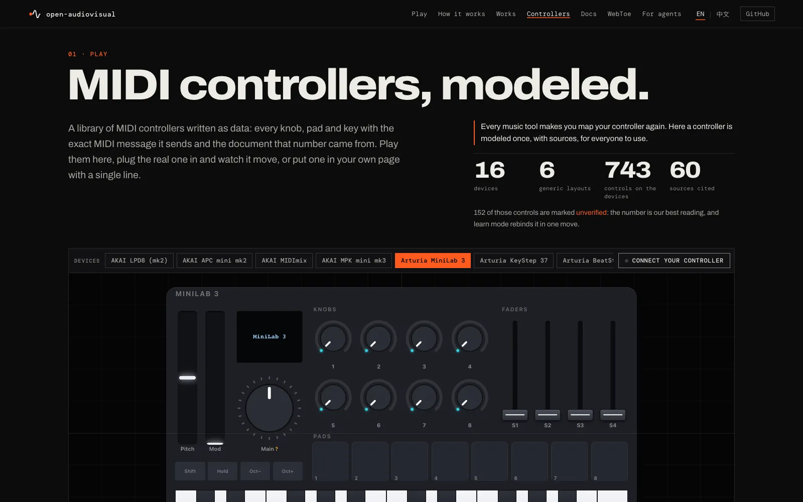</a>

Controllers are **data**: one JSON file per device with the faceplate, every control's exact MIDI
message, LED feedback, how to recognise its port, and the document each number came from.
The same file drives an on-screen controller you can play, follows the real device when you plug it in,
and drops into any web page. **<!--gen:devices-line-->21 devices, 1141 controls<!--/gen:devices-line-->** (plus <!--gen:n-generic-->6<!--/gen:n-generic--> generic layouts), each with its sources.

<!--gen:controllers-table-->
| maker | devices (spec sheet with the full MIDI map) |
|---|---|
| AKAI Professional | [**LPD8 (mk2)**](https://openaudiovisual.com/controllers/akai-lpd8/) · [**APC mini mk2**](https://openaudiovisual.com/controllers/akai-apc-mini-mk2/) · [**MIDImix**](https://openaudiovisual.com/controllers/akai-midimix/) · [**MPK mini mk3**](https://openaudiovisual.com/controllers/akai-mpk-mini-mk3/) · [**APC40 mkII**](https://openaudiovisual.com/controllers/akai-apc40-mk2/) |
| Arturia | [**MiniLab 3**](https://openaudiovisual.com/controllers/arturia-minilab3/) · [**KeyStep 37**](https://openaudiovisual.com/controllers/arturia-keystep37/) · [**BeatStep**](https://openaudiovisual.com/controllers/arturia-beatstep/) |
| Behringer | [**X-TOUCH MINI**](https://openaudiovisual.com/controllers/behringer-x-touch-mini/) |
| DJ TechTools | [**TechTools Midi Fighter Twister**](https://openaudiovisual.com/controllers/djtechtools-midi-fighter-twister/) |
| KORG | [**nanoKONTROL2**](https://openaudiovisual.com/controllers/korg-nanokontrol2/) · [**nanoKEY2**](https://openaudiovisual.com/controllers/korg-nanokey2/) |
| Novation | [**Launchpad Mini MK3**](https://openaudiovisual.com/controllers/novation-launchpad-mini-mk3/) · [**Launch Control XL (MK2)**](https://openaudiovisual.com/controllers/novation-launch-control-xl-mk2/) · [**Launch Control XL 3**](https://openaudiovisual.com/controllers/novation-launch-control-xl-3/) · [**Launchkey Mini MK3**](https://openaudiovisual.com/controllers/novation-launchkey-mini-mk3/) · [**Launchkey 25 MK4**](https://openaudiovisual.com/controllers/novation-launchkey-25-mk4/) · [**Launchkey 37 MK4**](https://openaudiovisual.com/controllers/novation-launchkey-37-mk4/) · [**Launchpad Pro MK3**](https://openaudiovisual.com/controllers/novation-launchpad-pro-mk3/) |
| ODD | [**ODD Ball**](https://openaudiovisual.com/controllers/odd-ball/) |
| teenage engineering | [**OP-1 field**](https://openaudiovisual.com/controllers/teenage-engineering-op-1-field/) |
<!--/gen:controllers-table-->

Embed one anywhere, one line:

```html
<script type="module" src="https://openaudiovisual.com/packages/midi/element.js"></script>
<oav-controller profile="akai-apc-mini-mk2"></oav-controller>
```

**Is your controller missing?** [Request it](https://github.com/frank890417/open-audiovisual/issues/new?title=MIDI%20controller%20request%3A%20) (a manual or a MIDI implementation chart helps), or add it yourself:

1. Copy the closest file in [`packages/midi/profiles/`](packages/midi/profiles/) (or a generic layout) and write each control's type and message from the manual.
2. Cite every source; mark anything unconfirmed `"verified": false` with a note.
3. `validateProfile(profile)` lists every problem, `npm test` checks every shipped profile; try it with `<oav-controller profile="./my-device.json">`.
4. Register it in `profiles/index.js` and open a pull request. Full steps: [docs/controllers.md](docs/controllers.md#add-a-controller).

## 🎨 p5.js in one line

Any p5.js sketch (OpenProcessing, the p5 editor, your own page) can be played from a MIDI controller,
a controller drawn on screen, or a phone. Add one line at the top:

```js
document.head.prepend(Object.assign(document.createElement('script'), { src: 'https://openaudiovisual.com/p5/oav-p5.js' }));
```

Then read the controller the way p5 reads the mouse:

```js
function draw() {
  background(knob1 * 255);                 // knob 1, 0..1, like mouseX
  circle(width / 2, height / 2, 50 + knob2 * 300);
}

function notePressed(note, velocity) {     // like keyPressed(): any key, or a pad
  circle(random(width), random(height), velocity * 100);
}
```

No `setup()` call, p5 1.x and 2.x. On OpenProcessing it also wires to OP Configurator sliders in order.

The same line does more, each one a call or a name in the p5 style (oav-p5 <!--gen:p5-version-->0.8.0<!--/gen:p5-version-->, [changelog](https://openaudiovisual.com/changelog/)):

| write | and | play it |
|---|---|---|
| `startSound('piano')` | every key from a keyboard, the 🎹 on screen or a phone is heard ([sound](https://openaudiovisual.com/docs/#p5-sound-what-is-played-is-heard)) | [16](https://openaudiovisual.com/examples/16-p5-sound/) |
| `micLevel`, `bass`, `beatDetected()` | the microphone, read like `mouseX`, no p5.sound ([microphone](https://openaudiovisual.com/docs/#p5-the-microphone)) | [17](https://openaudiovisual.com/examples/17-p5-microphone/) |
| `startDrums("bd*4, [~ sd]*2, hh*8")`, `cue(5, 'bloom')` | a drum machine written as one line of rhythm (click its grid and the line rewrites itself), and a timeline of bars ([drum machine](https://openaudiovisual.com/docs/#p5-drum-machine)) | [18](https://openaudiovisual.com/examples/18-p5-drums/) · [19](https://openaudiovisual.com/examples/19-p5-rhythm/) · [20](https://openaudiovisual.com/examples/20-p5-rhythm-visual/) |
| `startRecording()` | the canvas and the sketch's own sound in one video; ⏺ in the 🎹 panel needs no code ([recording](https://openaudiovisual.com/docs/#p5-recording-a-video-with-its-sound)) | [21](https://openaudiovisual.com/examples/21-p5-record/) |
| `lag(micLevel, 0.03, 0.4)` | a jumpy value smoothed like TouchDesigner's Lag CHOP, in its seconds; `env()`, `spring()`, `scope()` too ([values over time](https://openaudiovisual.com/docs/#p5-values-over-time-lag-env-speed-spring-trail)) | [22](https://openaudiovisual.com/examples/22-p5-lag/) |
| Strudel | load the line in strudel.cc: knobs, a phone and the microphone become Strudel's parameters, and its notes and clock reach a sketch ([With Strudel](https://openaudiovisual.com/docs/#strudel)) | [23](https://openaudiovisual.com/examples/23-p5-with-strudel/) |
Details: [openaudiovisual.com/docs/#p5](https://openaudiovisual.com/docs/#p5) · [docs/p5.md](docs/p5.md) · [`p5/`](p5/).

## 🧩 A world in 20 lines

```js
export const myWorld = {
  name: 'pulse',
  params: [{ key: 'rate', min: 0, max: 10, def: 2, label: 'Rate' }],
  init({ container, signals }) {
    this.view = createCanvas(container);
    this.r = 0;
    signals.on('midi/note/on', ({ vel }) => { this.r = 100 * vel; });
  },
  update(dt, state) { this.r = Math.max(0, this.r - dt * 60); this.rate = state.rate; },
  render() {
    const { ctx } = this.view, { w, h } = this.view.fit();
    ctx.fillStyle = '#000'; ctx.fillRect(0, 0, w, h);
    ctx.fillStyle = '#fff';
    ctx.beginPath(); ctx.arc(w / 2, h / 2, 20 + this.r, 0, 7); ctx.fill();
  },
  dispose() { this.view.dispose(); },
};
```

Register it on a `Stage`, feed it a `Timeline`, mount the `Console`: see
[`examples/01-hello-particles/main.js`](examples/01-hello-particles/main.js) for
the ~40 lines of assembly, and [docs/writing-a-world.md](docs/writing-a-world.md) for the full contract.

## 📱 Phone / iPad remote

`node serve.js`, open an example that declares `modules: { remote: true }` (try
[08](examples/08-remote-surface/)), and scan the QR code on the join card with your phone (or type its URL; same wifi).
On [openaudiovisual.com](https://openaudiovisual.com/examples/08-remote-surface/) there is no `serve.js`: the example
uses the public relay and a random room, and the QR code works the same.
Tabs: 感測 sensors (tilt · accel · touch · knock · light), 琴鍵 keys (one row landscape, two stacked rows
portrait), 控制台 control surface (faders, knobs, XY, pads… generated from the World's `params`, or from a layout JSON),
and MIDI. Details: [docs/remote.md](docs/remote.md).

## 🤖 Agent-native

Worlds are visual code, and coding agents are good at code, so this repo ships
agent-ready: [`AGENTS.md`](AGENTS.md) gives any AI coding agent the layer
contracts and conventions, and the bundled `/create-world` skill
([.claude/skills/create-world](.claude/skills/create-world/SKILL.md)) scaffolds a
runnable work from a natural-language description ("a jellyfish world that blooms
on consonant chords"). Describe the performance; the agent writes the World; the
chassis does the rest.

An **MCP server** ships in the box ([`.mcp.json`](.mcp.json), zero-dependency stdio):
`list_examples` · `read_doc` · `scaffold_world` · `run_checks` · `list_controllers` ·
`read_profile` · `validate_profile` · `scaffold_profile`. Connect any MCP-capable
agent and it can inspect, scaffold and verify a performance. Machine-readable entry points:
[`llms.txt`](llms.txt) · [`llms-full.txt`](llms-full.txt). (Positioning kin:
[open-slide](https://github.com/1weiho/open-slide), which does this for slide decks.)

## 📦 Packages

<!--gen:w-packages-->Twenty-seven<!--/gen:w-packages--> plain-ES-module packages in [`packages/`](packages/), no dependencies. Import what you need
through an import map, or let `createShow()` assemble them. Reference: [docs/packages.md](docs/packages.md).

<!--gen:packages-table-->
| layer | package | role |
|---|---|---|
| L1 input | [`@openav/midi`](packages/midi/) | Web MIDI in and out, many devices, on-screen controller profiles |
|  | [`@openav/audio`](packages/audio/) | Microphone analysis: loudness, bands, brightness, onsets, drum hits |
|  | [`@openav/chord`](packages/chord/) | Chord detection for performance: consonance, triads, clusters |
|  | [`@openav/pose`](packages/pose/) | Body and 21-point hand tracking from the camera, on the device |
|  | [`@openav/keys`](packages/keys/) | On-screen piano, QWERTY playing and a simulated performer |
|  | [`@openav/drums`](packages/drums/) | Synth kit and step sequencer that publish analyzer-shaped signals |
|  | [`@openav/leap`](packages/leap/) | Leap Motion hands through a small local bridge, as 21-point hand signals |
| L2 mapping | [`@openav/mapping`](packages/mapping/) | Signal to param routes: curves, smoothing, many-to-many, learn |
|  | [`@openav/chop`](packages/chop/) | Values over time, as TouchDesigner's CHOPs shape them: lag, envelope, speed, spring, trail, slope, count; the same curve at any frame rate |
| L3 world | [`@openav/stage`](packages/stage/) | The world shell: lifecycle and params, no renderer opinion |
|  | [`@openav/world-webtoe`](packages/world-webtoe/) | Perform a WebToe node patch as a world |
| L4 output | [`@openav/sound`](packages/sound/) | Instruments in the page (Salamander piano, mallets, strings, organ, synth presets), one file to add your own |
|  | [`@openav/osc`](packages/osc/) | OSC out of the browser through a small Node bridge to UDP |
|  | [`@openav/out`](packages/out/) | Page parameters to WLED lights, serial motor boards and OSC through one local bridge, with a watchdog that falls back to safe values |
|  | [`@openav/record`](packages/record/) | Performance video: the work above the webcam in one file with its own sound; MIDI takes recorded and replayed |
|  | [`@openav/fab`](packages/fab/) | Can it be made? A 3D-print check for any mesh (watertight, overhang, thinnest wall, grams) and STL, OBJ, GLB, STEP files |
| spines | [`@openav/timeline`](packages/timeline/) | Param automation, scenes and cues: the clock of the show |
|  | [`@openav/score`](packages/score/) | The show as segment lengths: cuts, cues, holds, and a director that keeps it running when a module fails |
|  | [`@openav/pattern`](packages/pattern/) | Rhythm in one line: TidalCycles/Strudel-style mini-notation read into the hits of each bar (Euclidean rhythms, one-per-bar alternation, seeded chance) |
|  | [`@openav/console`](packages/console/) | The director's desk and performance mode |
|  | [`@openav/monitor`](packages/monitor/) | Backstage view for any device on the network |
| phones and tablets | [`@openav/relay`](packages/relay/) | Zero-dependency room relay for phones and iPads |
|  | [`@openav/surface`](packages/surface/) | TouchOSC-style widgets and autoSurface(params) |
|  | [`@openav/remote`](packages/remote/) | The phone and iPad app: sensors, keyboard, control surface |
| glue and agents | [`@openav/core`](packages/core/) | Signals, Params and Loop: what every layer speaks |
|  | [`@openav/show`](packages/show/) | createShow(): one call assembles the whole shell |
|  | [`@openav/mcp`](packages/mcp/) | MCP server for coding agents: list, read, scaffold, check |
<!--/gen:packages-table-->

## 📚 Docs

**The handbook: [openaudiovisual.com/docs](https://openaudiovisual.com/docs/)** ([繁體中文](https://openaudiovisual.com/zh/docs/)): every chapter on one page, generated from [`docs/`](docs/).
**The MIDI controller library: [openaudiovisual.com/controllers](https://openaudiovisual.com/controllers/)**: every modeled controller, playable, with its MIDI map and sources.

| start here | go deeper |
|---|---|
| [Introduction](docs/introduction.md) · [Getting started](docs/getting-started.md) · [Core concepts](docs/concepts.md) | [Architecture](docs/architecture.md): the layer contracts, in detail |
| [Writing a world](docs/writing-a-world.md) · [Signals reference](docs/signals.md) · [Mapping](docs/mapping.md) | [Show control](docs/show-control.md): timeline, scenes, performance mode, monitor, OSC |
| [Inputs](docs/inputs.md) · [Controllers](docs/controllers.md) · [p5.js in one line](docs/p5.md) | [Score & Director](docs/score.md): a show as segment lengths |
| [Phones & remote](docs/remote.md) · [For AI agents](docs/agents.md) · [Troubleshooting](docs/troubleshooting.md) | [Roadmap](docs/roadmap.md) · [Packages](docs/packages.md) · [Lab integration](docs/lab-integration.md) |

## 🔭 Sister project: WebToe

<a href="https://openaudiovisual.com/webtoe/">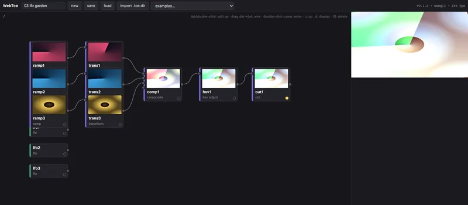</a>

[**WebToe**](https://github.com/frank890417/WebToe) is a web-native, node-based
dataflow engine (TouchDesigner-style, imports real `.toe` projects). The two are
halves of one stack: **WebToe is the engine, open-audiovisual is the show**.
A WebToe network can become an openav World, and openav's inputs (MIDI, chords,
pose) map naturally onto CHOP channels. The adapter is
[`@openav/world-webtoe`](packages/world-webtoe/) (example 04): it embeds the
[WebToe editor](https://webtoe.openaudiovisual.com/) and posts params into the
patch, where any parameter written as `ext('name', fallback)` follows.
More: [openaudiovisual.com/webtoe](https://openaudiovisual.com/webtoe/).

<br clear="right">

## 🌱 Design lineage

The core of this framework was extracted from **The Last Input** (Che-Yu Wu, 2026,
C-LAB Taiwan Sound Lab / IRCAM residency, performed on a 49.4-channel speaker dome).
The timeline, chord semantics, many-to-many MIDI-learn, and OSC batching all drove a
real 14-scene show before they were generalized here. The rule since then: the framework
only grows features a real show asked for. The mapping-layer philosophy
descends from [libmapper](http://libmapper.github.io/)'s signal-namespace research.

## 🛰 Telemetry

The controller element, `createController()`, the iframe embed and `createShow()` send one anonymous usage hit per page load (kind, controller profile, the page's origin, version; no cookies, nothing anyone plays). Nothing is sent from localhost, LAN addresses or `file://`. Off with `telemetry="off"` / `{ telemetry: false }` / `?telemetry=0` / `globalThis.OPENAV_TELEMETRY = false`. Details: [packages/midi/README.md](packages/midi/README.md#telemetry).

## 🗺 Status & roadmap

Framework version `0.1.0` (nothing is on npm yet); oav-p5, the one line for p5.js, is versioned on its own:
<!--gen:p5-version-->0.8.0<!--/gen:p5-version--> ([changelog](https://openaudiovisual.com/changelog/)). The chassis is complete and in use: the four layers with the
L4 video/audio split, timeline, **Score &amp; Director**, console, backstage monitor, phones as controllers,
**performance video** recording and MIDI takes, **Leap Motion** hands, a **<!--gen:n-devices-->21<!--/gen:n-devices-->-device MIDI controller library**,
**oav-p5** (sound, a drum machine with one line of rhythm, recording, TouchDesigner-style lag, Strudel side by side),
an MCP server, and a handbook site.

<!-- facts:start (written by tools/build-examples.mjs) -->
27 packages · 26 examples · 27 MIDI controller profiles (21 devices, 6 generic layouts, 1141 controls) · 747 tests
<!-- facts:end -->

Planned ([full roadmap](docs/roadmap.md)):

- Replay the full signal stream (hands, body, audio analysis) into any world
- The score on an external MIDI clock (clock in already moves oav-p5's drums), clock and transport out, a score editor on the desk
- Audience-device input: many phones as aggregate signals
- npm publish of `@openav/*`, a WebGPU world adapter
- An NDI gateway; several machines sharing one signal space over WebRTC; agents that play alongside people

## 🤝 Contributing

- **A controller you want:** [open an issue](https://github.com/frank890417/open-audiovisual/issues/new?title=MIDI%20controller%20request%3A%20). **A controller profile you made:** open a pull request ([how](docs/controllers.md#add-a-controller)).
- Read [`AGENTS.md`](AGENTS.md) first, human or agent: vanilla ESM, no build step, no runtime dependencies (a hard constraint), and the two rules above. Framework changes must make every example better; never edit `packages/*` to make one example look right.
- `npm test` (`node --test tests/*.test.js`) must stay green; add cases for any logic you touch.

Thanks to **[Miffy Chen](https://github.com/miffycs)**, whose pull request [#2](https://github.com/frank890417/open-audiovisual/pull/2) added the
teenage engineering **OP-1 field** profile (38 controls, every one checked on a real unit over USB), a few opt-in faceplate options for devices that don't look like the default, and the Behringer line in the controllers gallery description.

## License

MIT: build shows, teach classes, fork worlds. Attribution appreciated, not required.
Examples 05–07 are artworks by Che-Yu Wu, © the artist, all rights reserved (see above).
